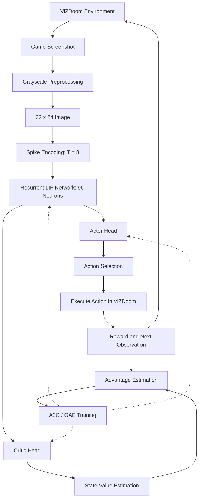

# Autonomous DOOM Gameplay Using Recurrent Spiking Neural Networks

An autonomous gameplay agent developed using **Recurrent Spiking Neural Networks (RSNNs)**, **reinforcement learning**, and the **ViZDoom** simulation environment.

The project implements an end-to-end perception-to-action pipeline in which a spiking neural network processes visual observations from DOOM, maintains internal neuronal states, and selects gameplay actions autonomously.

The implementation uses PyTorch for spiking neural computation and training, and ViZDoom for environment interaction and evaluation.

## 1. Project Overview

The objective of this project is to develop and evaluate an autonomous DOOM-playing agent based on spiking neural computation.

Unlike conventional artificial neural networks that primarily process continuous-valued activations, Spiking Neural Networks (SNNs) represent neuronal activity through discrete spikes evolving over time.

Our implementation uses a **Recurrent Spiking Neural Network**, allowing neurons to receive input from both the current visual observation and previous neuronal activity.

The agent interacts with ViZDoom through the following process:

1. Receives a screenshot of the current game state.
2. Converts the screenshot into a normalized grayscale representation.
3. Encodes the image into a sequence of input spikes.
4. Processes the spikes through recurrent Leaky Integrate-and-Fire (LIF) neurons.
5. Produces action scores using a policy network.
6. Selects and executes an action in ViZDoom.
7. Receives environmental feedback and continues interacting until the episode ends.

The network is trained using reinforcement learning, allowing its action-selection policy to be optimized using gameplay rewards.

The current implementation focuses on ViZDoom's **BASIC scenario**, a simplified environment involving horizontal movement and shooting a target.

## 2. Technologies Used

| Technology | Purpose |
|---|---|
| Python | Main implementation language |
| PyTorch | Neural network implementation, automatic differentiation and optimization |
| ViZDoom | DOOM gameplay simulation and environment interaction |
| NumPy | Numerical processing |
| Pillow | Image preprocessing |
| Reinforcement Learning | Training the autonomous action-selection policy |
| Surrogate Gradients | Enabling gradient-based learning in spiking neurons |
| CSV Logging | Recording training and evaluation results |

The network is implemented using custom PyTorch components rather than relying on a dedicated SNN simulation framework.

## 3. System Architecture

The complete system connects visual perception, spiking computation, action selection and environment feedback.



The system consists of five main stages.

### 3.1 Environment Interaction

ViZDoom provides visual observations, executes actions and supplies gameplay rewards.

The agent interacts with the environment using a discrete action space. Each episode continues until the game reaches a terminal condition or the episode time limit.

### 3.2 Visual Preprocessing

The current game screenshot is converted to grayscale and resized to 32 × 24 pixels.

This produces 768 normalized pixel values, forming the network's input representation.

### 3.3 Spike Encoding

Pixel intensities are converted into binary spike sequences across eight internal simulation timesteps.

This transforms image information into a temporal input suitable for spiking neurons.

### 3.4 Recurrent Spiking Computation

The encoded spikes are processed by 96 recurrent LIF neurons.

The network maintains membrane potentials and previous spike states, allowing information from earlier computations to influence subsequent neuronal activity.

### 3.5 Action Selection

The actor network produces scores for six gameplay actions.

During training, actions are sampled from the policy distribution. During greedy evaluation, the action with the highest score is selected.

The selected action is executed in ViZDoom and the process repeats.

## 4. ViZDoom Environment

We use the BASIC scenario provided by ViZDoom.

In this environment, the agent controls a character that can move horizontally and shoot an enemy.

### Available Actions

The agent can choose among six discrete actions.

| Index | Action | Description |
|---|---|---|
| 0 | `noop` | Perform no action |
| 1 | `left` | Move left |
| 2 | `right` | Move right |
| 3 | `shoot` | Fire the weapon |
| 4 | `left_shoot` | Move left while shooting |
| 5 | `right_shoot` | Move right while shooting |

Each selected action is applied for four game tics in the default configuration.

This means the agent chooses an action once for every four game tics, rather than selecting a new action on every internal SNN timestep.

### Observations

The neural network receives the game's screen buffer as its observation.

It does not directly receive privileged target coordinates as an input.

### Rewards

The environment provides rewards based on gameplay events.

The agent receives positive rewards for successful outcomes and negative rewards or penalties associated with unsuccessful or prolonged gameplay.

These rewards provide the learning signal used by the reinforcement-learning algorithm.

### Episodes

A training episode consists of a complete interaction sequence:

- Initialize the game.
- Reset the RSNN's neuronal states.
- Repeatedly observe the screen and select actions.
- Collect rewards and transitions.
- Finish the episode.
- Update the network using the recorded experience.

## 5. Input Preprocessing and Spike Encoding

### Image Preprocessing

Each observation undergoes the following transformation:

```text
ViZDoom RGB Screenshot
          |
          v
Convert to Grayscale
          |
          v
Resize to 32 x 24
          |
          v
Normalize Pixel Values to [0, 1]
          |
          v
Flatten to 768 Inputs
```

The reduced observation size keeps the neural network relatively compact.

### Deterministic Spike Encoding

The normalized pixel values are transformed into spike trains using an accumulator-based deterministic encoding mechanism.

At each spiking timestep, the pixel value is added to an accumulator.

When the accumulator reaches the spike threshold, an input spike is generated and the accumulator is reduced.

The resulting input consists of binary spike events:

- `1` represents a spike.
- `0` represents no spike.

The encoding is performed over eight internal timesteps per game decision.

Brighter image regions generally produce more frequent input spikes than darker regions.

This is a deterministic encoding mechanism, not stochastic Poisson sampling.

### Temporal Processing

The implementation uses two different notions of time:

**Game time:** The progression of ViZDoom, including actions applied for four game tics.

**Spiking time:** Eight internal neural simulation timesteps used to process each game observation.

These two timescales are distinct.

## 6. Recurrent Spiking Neural Network

The neural network is built around a recurrent layer of Leaky Integrate-and-Fire neurons.

### Architecture Configuration

| Component | Configuration |
|---|---|
| Input features | 768 |
| Hidden spiking neurons | 96 |
| Neuron type | Leaky Integrate-and-Fire |
| Membrane decay β | 0.5 |
| Firing threshold | 0.4 |
| Spiking timesteps per decision | 8 |
| Recurrent connectivity | 96 × 96 |
| Actor outputs | 6 |
| Critic outputs | 1 |

### Leaky Integrate-and-Fire Neurons

LIF neurons accumulate incoming current through a membrane potential.

The membrane potential gradually decays over time, controlled by the decay parameter β.

A simplified representation of the implemented update is:

\[
I_t = W_{\text{in}}x_t + W_{\text{rec}}s_{t-1}
\]

\[
u_t = \beta u_{t-1} + I_t - V_{\text{th}}s_{t-1}
\]

\[
s_t = H(u_t - V_{\text{th}})
\]

Where:

- \(I_t\) is the input current.
- \(W_{\text{in}}\) represents input synaptic weights.
- \(W_{\text{rec}}\) represents recurrent synaptic weights.
- \(x_t\) represents encoded input spikes.
- \(u_t\) is the membrane potential.
- \(s_t\) is the output spike.
- \(\beta\) is the membrane decay factor.
- \(V_{\text{th}}\) is the firing threshold.
- \(H\) is the binary threshold function.

For the current network, β is set to 0.5.

### Recurrent Connections

The recurrent layer contains a trainable 96 × 96 weight matrix.

These connections allow previous hidden-layer spikes to contribute to current neuronal input.

The network therefore processes both incoming visual information and its internal neuronal state.

### State Persistence

The model retains two internal states:

1. Hidden spike state.
2. Membrane-potential state.

These states persist between successive game decisions within an episode.

They are reset when a new episode begins.

This allows the model to maintain temporal information rather than independently processing every frame from a completely reset neuronal state.

### Actor and Critic Heads

The RSNN uses a shared spiking representation connected to two output heads.

**Actor Head**

The actor maps hidden spiking activity to six action logits. The logits define a categorical action distribution.

**Critic Head**

The critic estimates the expected discounted future reward associated with the current state.

The critic is used during reinforcement-learning training. The actor and spiking core perform the action-selection computation during inference.

### Network Resource Summary

| Resource | Count |
|---|---:|
| Spiking neurons | 96 |
| Input synapses | 73,728 |
| Recurrent synapses | 9,216 |
| Actor synapses | 576 |
| Critic synapses | 96 |
| Actor and spiking-core parameters, including biases | 83,622 |
| Total trainable parameters | 83,719 |

These counts describe the current PyTorch network architecture.

## 7. Reinforcement Learning

The project includes two RSNN training implementations.

### Initial RSNN Implementation

The initial RSNN uses the REINFORCE policy-gradient algorithm.

The model processes spiking observations, samples actions during training, and updates policy parameters using discounted episode returns.

This implementation establishes the initial autonomous spiking gameplay pipeline and provides a baseline for comparison.

### Actor-Critic RSNN Implementation

The current RSNN implementation uses **Advantage Actor-Critic (A2C)** with **Generalized Advantage Estimation (GAE)**.

The actor and critic share the recurrent spiking network as a feature extractor.

### Advantage Actor-Critic

The actor is responsible for selecting actions.

The critic estimates the value of a state, helping the training process assess whether observed actions produced better or worse outcomes than expected.

The actor is optimized through a policy-gradient loss weighted by estimated advantages.

The critic is optimized by minimizing the difference between predicted state values and training targets.

### Generalized Advantage Estimation

GAE combines temporal-difference errors across multiple steps.

The temporal-difference error is:

\[
\delta_t =
r_t + \gamma V(s_{t+1}) - V(s_t)
\]

The generalized advantage estimate is:

\[
A_t^{GAE} =
\sum_{l=0}^{T-t-1}
(\gamma\lambda)^l \delta_{t+l}
\]

with appropriate terminal masking and value bootstrapping at rollout boundaries.

The default configuration uses:

| Hyperparameter | Value |
|---|---:|
| Discount factor γ | 0.99 |
| GAE parameter λ | 0.95 |
| Gradient clipping threshold | 0.5 |
| Rollout length | 8 decisions |
| Default LIF decay β | 0.5 |

### Surrogate-Gradient Learning

Spiking neurons generate binary outputs, which makes conventional differentiation through the threshold function difficult.

The implementation uses a fast-sigmoid surrogate derivative:

\[
\frac{\partial s}{\partial u}
\approx
\frac{1}{(1+2|u-V_{\text{th}}|)^2}
\]

This enables gradient-based optimization through the recurrent LIF network.

### Truncated Backpropagation Through Time

The training pipeline uses rollout-based truncated backpropagation through time.

Instead of retaining an indefinitely growing computation graph, the system processes bounded sequences of game decisions and performs optimization updates.

The recurrent neuronal states remain available between rollout segments, while their gradient history is detached at the appropriate boundaries.

### Training Components

The current training pipeline includes:

- A2C policy optimization.
- Generalized Advantage Estimation.
- Entropy regularization.
- Actor and critic loss calculation.
- Configurable reward scaling.
- Configurable critic loss, including Huber loss.
- Gradient clipping.
- Recurrent-state handling.
- Periodic validation.
- Checkpoint saving and loading.
- Training statistics and CSV logging.

The implementation also supports diagnostics of action probabilities, policy entropy and actor/critic gradient behavior.

## 8. Training Process

The training loop performs the following operations:

```text
Initialize RSNN and ViZDoom
            |
            v
Start New Episode
            |
            v
Reset Neuronal States
            |
            v
Receive Observation
            |
            v
Encode Spikes and Run RSNN
            |
            v
Actor Samples Action
            |
            v
Execute Action and Collect Reward
            |
            v
Store Rollout Transitions
            |
            v
Compute GAE and Value Targets
            |
            v
Update Actor and Critic
            |
            v
Continue Episode or Start Next Episode
```

During training, actions are sampled from the categorical policy distribution. This allows the agent to explore different actions.

During greedy evaluation, the action with the highest logit is selected.

The software also supports stochastic evaluation, in which actions are sampled from the trained policy without updating the network.

### Training Experiments

The current experimental work includes:

- An initial RSNN trained with REINFORCE.
- An actor-critic RSNN trained using A2C and GAE.
- Short integration and validation runs.
- A 500-episode actor-critic training experiment.
- Evaluation across multiple environment seeds.
- Action-selection diagnostics.
- Comparisons against random and fixed-action policies.

The network architecture is held relatively compact, with 96 hidden spiking neurons and eight internal spiking timesteps.

## 9. Experimental Evaluation

The trained RSNN is evaluated against several baseline policies.

### Baseline Policies

**Random Agent**

Selects actions uniformly from the available action set.

**Always Shoot**

Continuously selects the shooting action.

**Always Left + Shoot**

Continuously moves left while shooting.

**Initial RSNN**

Uses the original recurrent spiking policy trained with REINFORCE.

**Actor-Critic RSNN**

Uses the recurrent spiking model trained with A2C and GAE.

### Evaluation Metrics

The evaluation pipeline records:

- Kill success rate.
- Mean episode reward.
- Mean decisions per episode.
- Number of successful episodes.
- Action-selection frequencies.
- Policy entropy.
- Action probabilities.
- Spike activity.
- Other diagnostic statistics.

### Current Evaluation Results

The following results were obtained using the selected checkpoint from the 500-episode actor-critic training run.

Evaluation used the ViZDoom BASIC scenario, 100 episodes for each of three environment seeds, and greedy action selection for the trained neural policies.

| Policy | Kill Success | Mean Reward | Mean Decisions |
|---|---:|---:|---:|
| Random | 80.0% | −46.5 | 25.6 |
| Always shoot | 70.3% | −61.3 | 24.8 |
| Always left + shoot | 78.7% | −18.8 | 18.6 |
| Initial RSNN | 72.3% | −18.3 | 22.4 |
| **Actor-Critic RSNN** | **81.3%** | **+9.2** | **16.6** |

The actor-critic RSNN achieved 244 successful kills across 300 evaluation episodes.

It also obtained the highest mean episode reward and lowest mean number of decisions among the evaluated policies.

These results demonstrate the behavior of the selected checkpoint under this particular scenario and evaluation configuration. The relatively small kill-rate differences between the strongest policies should not be interpreted as proof of statistical superiority.

### Action-Selection Analysis

The evaluation pipeline also records the distribution of chosen actions and the corresponding policy probabilities.

For the selected actor-critic RSNN checkpoint, greedy evaluation selected primarily:

| Action | Approximate share |
|---|---:|
| No-op | 58% |
| Shoot | 21% |
| Left + shoot | 21% |

The model uses different actions during gameplay rather than selecting the same action for every decision.

These observations describe the model's action behavior. They do not, by themselves, establish accurate object recognition or target tracking.

### Recurrent and Visual Input Diagnostics

The project also includes experimental tools for examining the influence of visual inputs and recurrent connections.

The earlier RSNN was tested under several conditions:

| Condition | Kill Success (30 Episodes) |
|---|---:|
| Normal visual input | 70.0% |
| Constant-value input | 53.3% |
| Spatially shuffled input | 20.0% |
| Recurrent feedback disabled | 13.3% |

These diagnostics demonstrate that disrupting the input representation or recurrent network affects the resulting behavior and performance.

They are sensitivity experiments rather than a direct comparison against a separately trained feedforward SNN.

## 10. Repository Structure

The main implementation includes the following components:

```text
rsnn_doom_quickstart/
|
|-- rsnn_doom.py
|-- rsnn_v2.py
|-- train_rsnn_v2.py
|-- evaluate_rsnn_v2.py
|-- doom_env.py
|
|-- random_baseline.py
|-- diagnose_rsnn_policy.py
|-- check_rsnn_behavior.py
|
|-- tests/
|
|-- checkpoints/
|   |-- rsnn.pt
|   |-- v2/
|       |-- latest.pt
|       |-- best.pt
|
|-- results/
|   |-- v2/
|
|-- requirements.txt
|-- README.md
```

### Main Components

| File | Description |
|---|---|
| `rsnn_doom.py` | Original recurrent spiking gameplay agent and REINFORCE training implementation |
| `rsnn_v2.py` | Actor-critic recurrent spiking neural network |
| `train_rsnn_v2.py` | A2C/GAE training and checkpoint management |
| `evaluate_rsnn_v2.py` | Evaluation of trained policies and baseline agents |
| `doom_env.py` | ViZDoom environment setup, preprocessing and rollout utilities |
| `random_baseline.py` | Random-action gameplay baseline |
| `diagnose_rsnn_policy.py` | Action-selection and gameplay diagnostics |
| `check_rsnn_behavior.py` | Visual-input and recurrent-feedback sensitivity experiments |
| `tests/` | Automated tests |
| `checkpoints/` | Saved trained model states |
| `results/` | Training and evaluation logs |

## 11. Installation

### Requirements

- Python 3.12 or a compatible Python version.
- PyTorch.
- ViZDoom.
- NumPy.
- Pillow.
- Dependencies specified in `requirements.txt`.

Install the required packages from the project directory:

```powershell
python -m pip install -r requirements.txt
```

Ensure that the ViZDoom BASIC scenario configuration and corresponding WAD file are available.

The development setup uses the following relative configuration path:

```text
../ViZDoom/scenarios/basic.cfg
```

## 12. Running the Project

The following examples use Windows PowerShell from the `rsnn_doom_quickstart` directory.

### Run Automated Tests

```powershell
python -m pytest -q
```

### Run the RSNN Smoke Test

```powershell
python train_rsnn_v2.py --mode smoke
```

The smoke test checks the model's basic forward and backward operations without requiring an active ViZDoom gameplay episode.

### Train the Actor-Critic RSNN

```powershell
python train_rsnn_v2.py --episodes 100 --rollout-steps 8 --config ../ViZDoom/scenarios/basic.cfg
```

The number of episodes and training parameters can be configured through command-line arguments.

### Evaluate the Trained RSNN

```powershell
python evaluate_rsnn_v2.py --episodes 100 --seeds 6201 6202 6203 --config ../ViZDoom/scenarios/basic.cfg --v1-checkpoint checkpoints/rsnn.pt --v2-checkpoint checkpoints/v2/best.pt
```

This command compares the selected RSNN checkpoint against the initial RSNN and baseline action policies.

### Show Available Options

```powershell
python train_rsnn_v2.py --help
python evaluate_rsnn_v2.py --help
```

These commands display the configurable options supported by the installed script versions.

## 13. Experiment Logging and Checkpoints

The training and evaluation pipeline saves experiment artifacts for analysis and reproducibility.

### Checkpoints

Model checkpoints store trained network parameters and associated configuration information.

The training system maintains:

- A latest checkpoint representing the most recently saved training state.
- A best-validation checkpoint selected according to the configured validation procedure.

### Training Logs

Training statistics are recorded in CSV files.

Depending on the experiment configuration, these include:

- Episode number.
- Episode reward.
- Kill outcome.
- Number of decisions.
- Actor and critic losses.
- Policy entropy.
- Gradient statistics.
- Mean spike activity.
- Action counts.
- Training configuration.

### Evaluation Logs

Evaluation outputs contain per-episode policy results and aggregate statistics.

The system also supports action-distribution and probability diagnostics for examining the behavior of trained policies.

## 14. Current Implementation Summary

The project currently contains a functioning software pipeline for autonomous DOOM gameplay using recurrent spiking computation.

The implemented system includes:

- Visual interaction with the ViZDoom BASIC scenario.
- Grayscale image preprocessing and deterministic spike encoding.
- A custom recurrent LIF spiking network.
- Persistent neuronal states between game decisions.
- Six-action autonomous gameplay control.
- An initial REINFORCE-trained RSNN.
- An A2C/GAE-trained actor-critic RSNN.
- Surrogate-gradient optimization.
- Rollout-based temporal training.
- Model checkpointing and experiment logging.
- Baseline comparisons and gameplay evaluation.
- Action-probability, entropy and gradient diagnostics.
- Visual-input and recurrent-feedback sensitivity experiments.

The current experiments demonstrate that recurrent spiking computation can be integrated with reinforcement learning to produce an autonomous ViZDoom gameplay agent.

The evaluated actor-critic checkpoint achieved **81.3% kill success across 300 BASIC-scenario evaluation episodes**, with an average reward of **+9.2**.

The present implementation is a PyTorch-based software model and has been evaluated in the ViZDoom BASIC environment. Its reported results characterize this specific experimental setting rather than general DOOM gameplay performance.

The repository provides the source code, training workflow, saved-model interfaces and evaluation tools needed to reproduce and analyze the current software experiments.
