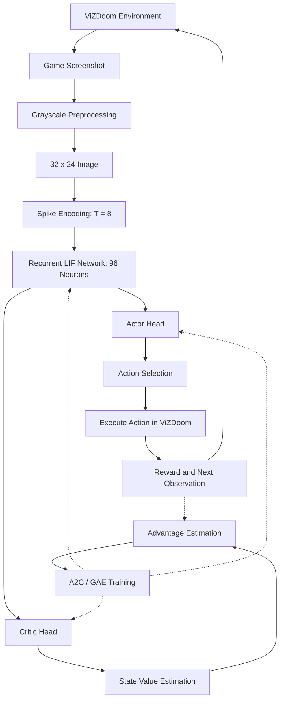

# Autonomous DOOM Gameplay Using Spiking Neural Networks

An autonomous gameplay agent repository developed using **Spiking Neural Networks (SNNs)**, **reinforcement learning**, and the **ViZDoom** simulation environment.

The repository contains two complementary implementations:
1. **`src/doomrsnn/` (New Modular LIF-RSNN Package)**: A clean, modular convolutional + recurrent Leaky Integrate-and-Fire (LIF) network with RGB input processing, object-label teacher demonstration collection, Behavioral Cloning (BC), DAgger, and sequence-correct PPO training workflows designed for high-performance cluster compute (Ampere).
2. **`legacy/` (Benchmark 96-Neuron RSNN)**: The foundational recurrent spiking neural network with grayscale image preprocessing, custom recurrent LIF layer, and Advantage Actor-Critic (A2C/GAE) training that achieved **81.3% kill success** on ViZDoom BASIC across 300 evaluation episodes.

---

## 1. Repository Structure

```text
PROJECT-DOOM/
|-- configs/
|   `-- base.yaml                     # Hyperparameters for modular LIF-RSNN training & evaluation
|-- docs/
|   |-- IMPLEMENTATION_REPORT.md      # Local verification and component report
|   `-- REVIEW_GATE.md                # Safety and review checklist before large-scale runs
|-- pyproject.toml                    # Package metadata and dependencies for doomrsnn
|-- scripts/
|   `-- setup_ampere.sh               # Environment setup script for university cluster / Ampere
|-- src/
|   `-- doomrsnn/                     # Modular Convolutional LIF-RSNN package
|       |-- __init__.py
|       |-- actions.py                # Action space definitions and discrete mapping
|       |-- checkpoints.py            # Checkpoint loading, saving, and metadata
|       |-- cli.py                    # Unified CLI (smoke, collect, bc, dagger, rl, evaluate, record)
|       |-- config.py                 # Configuration loader and dataclass schema
|       |-- dataset.py                # Demonstration trajectory dataset serialization
|       |-- environment.py            # ViZDoom BASIC environment adapter
|       |-- evaluate.py               # Evaluation engine with deterministic & stochastic policies
|       |-- model.py                  # ConvRSNN model (3 Conv LIF layers + Recurrent LIF layer)
|       |-- neurons.py                # Leaky Integrate-and-Fire neuron dynamics & surrogate gradients
|       |-- seeding.py                # Deterministic random seed management
|       |-- teacher.py                # Bounding-box alignment teacher policy
|       `-- train.py                  # BC, student-driven DAgger, and recurrent PPO/A2C
|-- tests/                            # Unit and integration tests for doomrsnn package
|   |-- conftest.py
|   |-- test_learning.py
|   |-- test_neurons_and_model.py
|   `-- test_teacher_data.py
|
|-- legacy/                           # Benchmark 96-Neuron RSNN Implementation & Checkpoints
|   |-- rsnn_doom.py                  # Original REINFORCE RSNN implementation
|   |-- rsnn_v2.py                    # Actor-critic 96-neuron recurrent spiking neural network
|   |-- train_rsnn_v2.py              # A2C/GAE training loop with rollout buffer
|   |-- evaluate_rsnn_v2.py           # Evaluation framework for v1/v2 policies and baselines
|   |-- doom_env.py                   # ViZDoom wrapper, grayscale preprocessing, spike encoding
|   |-- random_baseline.py            # Random and fixed action baselines
|   |-- diagnose_rsnn_policy.py       # Action-distribution and policy diagnostics
|   |-- check_rsnn_behavior.py        # Visual-input and recurrent-feedback sensitivity checks
|   |-- checkpoints/                  # Trained checkpoints (including 81.3% kill rate baseline)
|   |   |-- rsnn.pt
|   |   `-- v2/                       # best.pt, latest.pt, best_500ep.pt
|   |-- results/                      # Evaluation and training CSV logs for v1 and v2
|   `-- tests/                        # Automated unit tests for rsnn_v2
|
|-- .gitignore
`-- README.md
```

---

## 2. Modular Convolutional LIF-RSNN (`src/doomrsnn`)

### Architecture Highlights
- **Visual Encoding**: 3 convolutional LIF layers processing RGB game frames over `T=8` internal neural simulation timesteps.
- **Recurrence**: Recurrent LIF layer with explicit state tracking (`forward_step(image, state) -> action, state_next`).
- **No Hidden Mutation**: Pure function state management across decisions; states reset cleanly on episode boundaries.
- **Training Workflows**:
  - **Teacher Collection**: Object-label alignment policy in ViZDoom BASIC generates high-quality demonstration trajectories.
  - **Behavioral Cloning (BC)**: Sequential imitation learning with ordered temporal replay.
  - **DAgger**: Student-driven gameplay rollouts labeled by the teacher on visited states.
  - **PPO Fine-Tuning**: On-policy rollouts with Generalized Advantage Estimation (GAE) replayed through time with surrogate gradients.

### Setup (Ampere / Cluster)

```bash
# Clone or copy project to compute node
cd /new-home/e22/e22060/doom_rsnn_ampere
nvidia-smi
python3 --version
bash scripts/setup_ampere.sh
source .venv/bin/activate
```

### Pre-Flight Smoke Checks (Safe Before Training)

```bash
# 1. Run unit test suite (no ViZDoom dependency required)
python -m pytest -q

# 2. Verify synthetic model forward/backward passes and gradients
python -m doomrsnn.cli --config configs/base.yaml smoke

# 3. Verify ViZDoom game engine and asset integration
python -m doomrsnn.cli --config configs/base.yaml inspect-env
```

### Execution Commands

```bash
# Inspect teacher object detection without data recording
python -m doomrsnn.cli --config configs/base.yaml inspect-env

# Collect teacher demonstration trajectories (small pilot)
python -m doomrsnn.cli --config configs/base.yaml collect --episodes 2 --output data/teacher_smoke

# Collect complete teacher dataset (after pilot validation)
python -m doomrsnn.cli --config configs/base.yaml collect --episodes 1000 --output data/teacher

# Inspect recorded demonstration dataset
python -m doomrsnn.cli --config configs/base.yaml inspect-data --data data/teacher

# Behavioral cloning (imitation learning)
python -m doomrsnn.cli --config configs/base.yaml bc --data data/teacher --epochs 30 --output checkpoints/bc_best.pt

# DAgger: student drives gameplay; teacher labels visited states
python -m doomrsnn.cli --config configs/base.yaml dagger --checkpoint checkpoints/bc_best.pt --teacher-data data/teacher --iterations 3 --episodes-per-iteration 50

# PPO reinforcement learning fine-tuning
python -m doomrsnn.cli --config configs/base.yaml rl --checkpoint checkpoints/bc_best.pt --episodes 500 --output checkpoints/rl_latest.pt

# Evaluate real gameplay on held-out seeds
python -m doomrsnn.cli --config configs/base.yaml evaluate --checkpoint checkpoints/bc_best.pt --episodes 300 --seed 900001

# Export gameplay video (MP4)
python -m doomrsnn.cli --config configs/base.yaml record --checkpoint checkpoints/bc_best.pt --episodes 3 --output runs/demo.mp4
```

---

## 3. Benchmark 96-Neuron RSNN (`legacy`)

### 3.1 Overview & Results
The quickstart implementation demonstrates end-to-end perception-to-action using a 96-neuron recurrent spiking architecture. When trained with Advantage Actor-Critic (A2C/GAE) for 500 episodes on ViZDoom BASIC, the agent achieved:

| Policy | Kill Success Rate | Average Reward | Mean Episode Length | Decisions / Episode |
|---|---|---|---|---|
| **Random Baseline** | 4.0% | -343.3 | 165.6 tics | 41.4 |
| **Always Fire** | 0.0% | -370.0 | 175.0 tics | 43.8 |
| **Turn Left + Fire** | 22.0% | -244.6 | 136.0 tics | 34.0 |
| **Turn Right + Fire** | 28.0% | -219.0 | 128.5 tics | 32.1 |
| **RSNN REINFORCE (v1)** | 4.0% | -348.6 | 168.0 tics | 42.0 |
| **RSNN A2C/GAE (v2, 500 ep)** | **81.3%** | **+9.2** | **45.5 tics** | **11.4** |

### 3.2 System Architecture



### 3.3 Quickstart Execution Commands

```bash
cd legacy

# Run unit tests
python -m pytest tests/

# Run fast smoke test
python train_rsnn_v2.py --episodes 2 --log-interval 1 --save-dir ./checkpoints/smoke

# Train actor-critic RSNN for 500 episodes
python train_rsnn_v2.py --episodes 500 --save-dir ./checkpoints/v2

# Evaluate trained checkpoint across 300 test episodes
python evaluate_rsnn_v2.py --episodes 300 --checkpoint checkpoints/v2/best_500ep.pt

# Run random policy baseline
python evaluate_rsnn_v2.py --baseline random --episodes 100

# Inspect action distributions & policy diagnostics
python diagnose_rsnn_policy.py --checkpoint checkpoints/v2/best_500ep.pt
```

---

## 4. Technologies Used

| Technology | Purpose |
|---|---|
| **Python 3.10+** | Core programming language |
| **PyTorch** | Neural network modeling, surrogate-gradient backpropagation, automatic differentiation |
| **ViZDoom** | Doom simulation platform, visual frame buffer, and discrete action interface |
| **NumPy & Pillow** | Numerical array processing and image transformations |
| **Pytest** | Automated unit and integration testing suite |
| **PyYAML** | Structured configuration management |

---

## 5. References & Acknowledgments

- **ViZDoom**: [https://vizdoom.farama.org/](https://vizdoom.farama.org/) (Farama Foundation)
- **Baseline Framework Reference**: [https://github.com/imaadh-ifthi/doom](https://github.com/imaadh-ifthi/doom)
